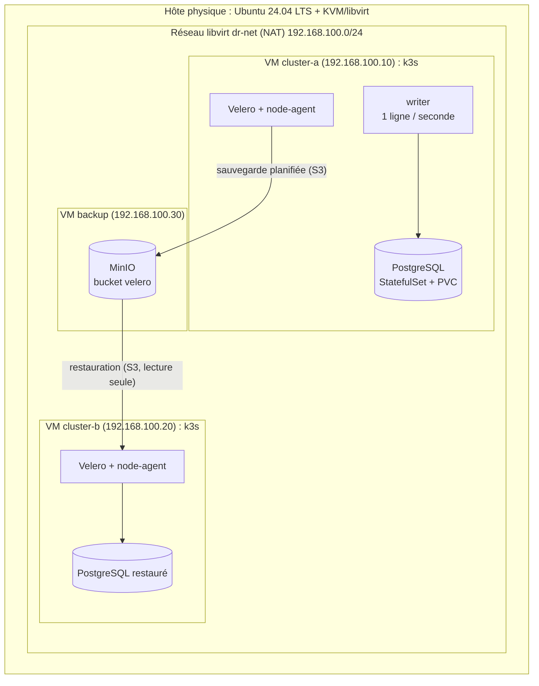

# Document d'architecture

Projet d'option ASL-IA 2026-2027, Sujet 8 : Sauvegarde et reprise après sinistre
Groupe : Ahmad SAAD, Amer EL JIBBAWE, Ali TERRO
Version : J1 (cadrage), 06/11/2026

## 1. Objectif

Une application à état (base PostgreSQL alimentée en continu) tourne sur un cluster
Kubernetes de production (cluster A). Le cluster A est sauvegardé régulièrement vers
un stockage objet situé hors du cluster. Lors d'un sinistre, le cluster A est
détruit entièrement ; l'application et ses données sont restaurées sur un second
cluster (cluster B). On mesure :

- **RTO** (Recovery Time Objective) : temps entre le sinistre et le retour du service
  sur le cluster B ;
- **RPO** (Recovery Point Objective) : quantité de données perdues, exprimée en temps
  (écart entre la dernière écriture avant le sinistre et la dernière écriture restaurée).

## 2. Vue d'ensemble

Principe clé : **la cible de sauvegarde ne partage rien avec le cluster protégé**.
Détruire la VM `cluster-a` (disque compris) ne touche ni aux sauvegardes ni au
cluster de reprise.

## 3. Composants

| Composant | Rôle | Choix | ADR |
|-----------|------|-------|-----|
| Système hôte | Exécuter les VM | Ubuntu Server 24.04 LTS | [0003](adr/0003-os-virtualisation.md) |
| Virtualisation | Créer et détruire les VM par script | KVM/libvirt + cloud-init | [0003](adr/0003-os-virtualisation.md) |
| Kubernetes | Orchestrer l'application | k3s, un nœud par cluster | [0003](adr/0003-os-virtualisation.md) |
| Application | Générer des données à protéger | PostgreSQL + écrivain horodaté | - |
| Outil de sauvegarde | Sauvegarder ressources K8s et volumes | Velero | [0001](adr/0001-outil-sauvegarde.md) |
| Copie des volumes | Copier les données des PVC | Velero File System Backup (Kopia) | [0004](adr/0004-copie-volumes.md) |
| Stockage des sauvegardes | Conserver les sauvegardes hors cluster | MinIO sur VM dédiée | [0002](adr/0002-stockage-sauvegardes.md) |

### 3.1 Application à état
- PostgreSQL déployé en StatefulSet, volume persistant via `local-path-provisioner`
  (stockage par défaut de k3s).
- Un pod `writer` insère une ligne par seconde dans une table `events(id, ts)`.
  Cette table sert de témoin : après restauration, `max(ts)` donne directement le
  point de reprise, donc le RPO.

### 3.2 Velero
- Installé sur les deux clusters avec le plugin AWS (compatible S3) pointant vers MinIO.
- Cluster A : `BackupStorageLocation` en lecture/écriture, `Schedule` périodique.
- Cluster B : même `BackupStorageLocation` en **lecture seule**, pour ne jamais
  écraser les sauvegardes de A pendant une reprise.
- Volumes copiés par le `node-agent` (Kopia), avec un hook PostgreSQL pour obtenir
  une copie cohérente (voir ADR 0004).

## 4. Réseau et adressage

| Élément | Adresse | Accès |
|---------|---------|-------|
| Réseau libvirt `dr-net` | 192.168.100.0/24, NAT, passerelle .1 | Sortie Internet par l'hôte |
| `cluster-a` | 192.168.100.10 | SSH depuis l'hôte, API k3s :6443 |
| `cluster-b` | 192.168.100.20 | SSH depuis l'hôte, API k3s :6443 |
| `backup` | 192.168.100.30 | API S3 :9000, console :9001 |

Les adresses sont fixées par réservation DHCP (adresse MAC définie dans le script de
création), pour que la reconstruction redonne toujours les mêmes adresses.
Le réseau interne de chaque k3s utilise les valeurs par défaut (pods 10.42.0.0/16,
services 10.43.0.0/16) ; les deux clusters étant séparés, il n'y a pas de conflit.

## 5. Dimensionnement

| VM | vCPU | RAM | Disque |
|----|------|-----|--------|
| cluster-a | 2 | 4 Go | 30 Go |
| cluster-b | 2 | 4 Go | 30 Go |
| backup | 1 | 2 Go | 20 Go système + 50 Go données |
| **Total** | **5** | **10 Go** | **130 Go** |

Hôte : non encore spécifié. Un hôte de 16 Go de RAM
suffit ; la marge restante sert à l'hôte et aux mesures.

## 6. Scénario de sinistre et de reprise

1. **Fonctionnement normal** : `writer` écrit dans PostgreSQL ; Velero sauvegarde le
   namespace de l'application vers MinIO selon le `Schedule`.
2. **Sinistre** (`make disaster`) : la VM `cluster-a` est détruite et son disque
   supprimé (`virsh destroy` + `virsh undefine --remove-all-storage`). L'heure est
   enregistrée (t0).
3. **Reprise** (`make restore`) : sur `cluster-b`, Velero liste les sauvegardes
   présentes dans MinIO et restaure la plus récente.
4. **Validation** : pods `Ready`, PostgreSQL répond, `count(*)` et `max(ts)` lus dans
   `events`. L'heure de retour du service est enregistrée (t1).
5. **Calcul** : RTO = t1 - t0 ; RPO = (dernière écriture avant t0) - `max(ts)` restauré.

## 7. Mesures prévues (J4)

Stratégies comparées, chacune avec au moins 3 répétitions (médiane et dispersion) :

| Stratégie | Principe | RPO attendu |
|-----------|----------|-------------|
| S1 | Velero planifié (toutes les heures, puis toutes les 15 min) | Jusqu'à la période |
| S2 | `pg_dump` en CronJob vers MinIO, en plus de Velero pour les manifestes | Jusqu'à la période |
| S3 | Archivage continu des WAL PostgreSQL vers MinIO (WAL-G ou pgBackRest) | Quelques secondes |

Indicateurs mesurés : RTO, RPO, durée et taille de chaque sauvegarde, charge CPU
pendant la sauvegarde.

## 8. Sécurité minimale
- Aucun secret dans Git : identifiants MinIO et kubeconfig générés au déploiement,
  fichiers listés dans `.gitignore`.
- Un utilisateur MinIO dédié à Velero, limité au bucket `velero`.
- Cluster B en lecture seule sur les sauvegardes.

## 9. Reproductibilité
Toute la plateforme est créée par script depuis ce dépôt (`make up`), et détruite
par `make destroy`. Les versions (image Ubuntu, k3s, Velero, MinIO, PostgreSQL)
seront figées dans `versions.yaml` au jalon J2. Le jalon J5 vérifie qu'un membre qui
n'a jamais monté la plateforme la reconstruit en suivant uniquement le README.

## 10. Limites connues
- Un seul hôte physique : un sinistre matériel réel de l'hôte n'est pas couvert ; il
  est simulé au niveau des VM. Une extension possible est de placer `backup` sur une
  seconde machine.
- Clusters à un seul nœud : la haute disponibilité n'est pas l'objet du sujet.
- MinIO Community Edition n'est plus maintenu en amont (voir ADR 0002 et risque R3).

